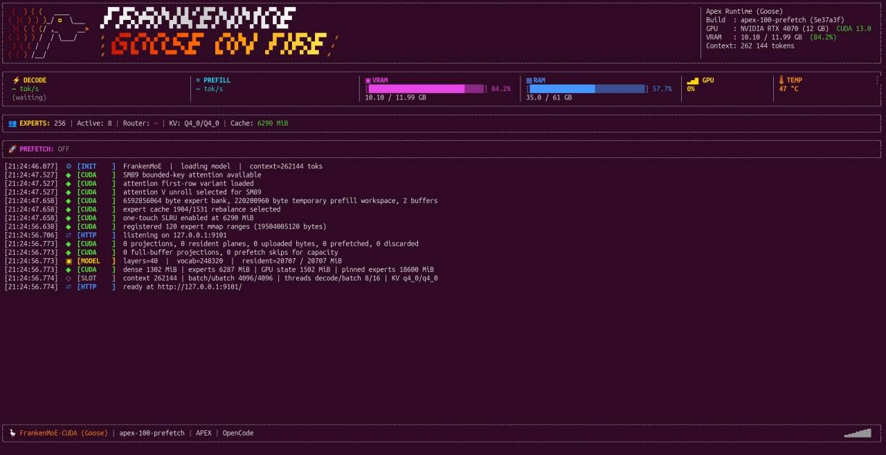

# FrankenMoE-CUDA

FrankenMoE runs local LLM inference with Goose model code and native C adapters
for the operating system and NVIDIA CUDA driver. It supports expert streaming
for models whose weights exceed GPU memory.
Learn about the language in the [original Goose repository](https://github.com/aardappel/goose).



## Downloads and verified models

The [v0.13.0-alpha](https://github.com/Endorpheen/FrankenMoE-CUDA/releases/tag/v0.13.0-alpha)
Linux x64 package runs Apex, Inkling and Bonsai on Goose/CUDA. Short
real-model generation was verified on an RTX 4070 12 GB (SM89). The bundled
HTTP binaries require glibc 2.43 or later. Model GGUF files are separate.

- [Linux x64 archive](https://github.com/Endorpheen/FrankenMoE-CUDA/releases/download/v0.13.0-alpha/FrankenMoE-v0.13.0-alpha-linux-x64.tar.gz)
- [Experimental Windows x64 archive](https://github.com/Endorpheen/FrankenMoE-CUDA/releases/download/v0.13.0-alpha/FrankenMoE-v0.13.0-alpha-windows-x64.zip)
- [SHA-256 checksums](https://github.com/Endorpheen/FrankenMoE-CUDA/releases/download/v0.13.0-alpha/SHA256SUMS)

| Linux checkpoint on RTX 4070, 32K/512 | Prefill, tok/s | Decode, tok/s |
| --- | ---: | ---: |
| Apex 35B V1.0 Q4_K_M HTTP | 3505.42 | 82.10 |
| Inkling 2 Mini AD-IQ4_XS HTTP | 296.24 | 22.03 |
| Ternary Bonsai 2.5 27B PQ2_0 HTTP | 648.79 | 32.70 |
| Ternary Bonsai 2.5 27B PQ2_0 greedy MTP CLI | 618.10 | 72.12 |

These are single-response results from the corresponding release checkpoints.
See the [multi-model guide](docs/MULTIMODEL-ALPHA.md) for the model profiles,
measurement conditions and limits.

The published Windows ZIP includes Apex HTTP and an experimental Bonsai
CUDA MTP CLI. Apex loaded real weights under Wine and returned HTTP 200 on
`/health`. The one-token CPU request timed out. Native Windows CUDA
inference remains untested. The published Windows ZIP does not contain
Inkling or Bonsai HTTP. Both have a separate
[Windows package candidate](docs/WINDOWS-MULTIMODEL.md).

## Start a model on Linux

Run one model per GPU from the extracted archive.

```bash
./frankenmoe apex /path/to/Apex-35B-V1.0-Q4_K_M.gguf
./frankenmoe inkling /path/to/Inkling-2-Mini-AD-IQ4_XS.gguf
./frankenmoe bonsai /path/to/Ternary-Bonsai-2.5-27B-PQ2_0-mtp.gguf
```

Open the loopback address printed by the server. Use raw `/completion`
for the verified Inkling and Bonsai HTTP paths. The Apex chat server
supports OpenCode through its OpenAI-compatible `/v1` endpoint. Python 3
enables the **Goose on Fire** terminal dashboard. Set
`FRANKENMOE_CONSOLE=0` for plain logs.

On Windows, run `start.bat` for Apex or follow `bonsai/README.md` in the
ZIP for the Bonsai MTP CLI.

## Build and verification

- [Build and packaging guide](docs/BUILD.md) covers the source-tree Apex build
  and the separate release checkpoints.
- [Release Gate](docs/RELEASE-GATE.md) records evidence per OS, backend and
  model before publication.
- [Architecture acceptance registry](docs/goose-migration/MODEL-ARCHITECTURES.md)
  tracks the reference requirements for adding a model.
- [Experiment registry](experiments/EXPERIMENTS.md) records source changes,
  benchmark conditions and correctness checks.
- [Vulkan roadmap](docs/roadmap/VULKAN-BACKEND.md) describes the deferred AMD
  backend.

Run `bash tools/check.sh fast` to compose and compile the source-tree Goose
unit without model weights.
