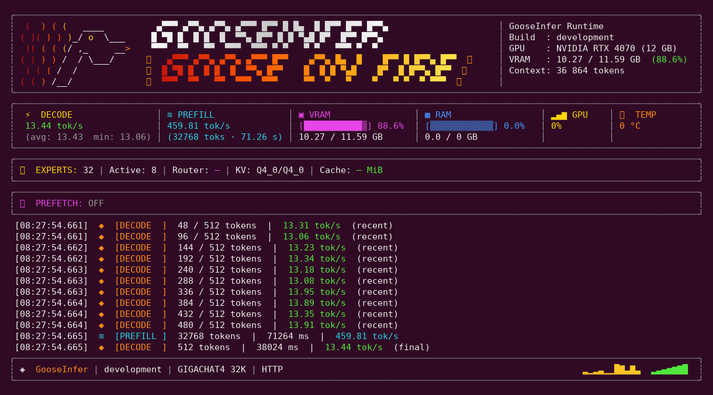

# GooseInfer

GooseInfer is a high-performance LLM inference engine written in Goose.
It supports multiple model architectures and streams expert weights for
models larger than consumer GPU memory. GooseInfer provides CUDA and
experimental Vulkan builds. See the [Goose language repository](https://github.com/aardappel/goose)
for language documentation.



## Downloads and verified models

The [v0.13.0-alpha](https://github.com/Endorpheen/GooseInfer/releases/tag/v0.13.0-alpha)
Linux x64 package runs Apex, Inkling and Bonsai on Goose/CUDA. Short
real-model generation was verified on an RTX 4070 12 GB (SM89). The bundled
HTTP binaries require glibc 2.43 or later. Model GGUF files are separate.

- [Linux x64 archive](https://github.com/Endorpheen/GooseInfer/releases/download/v0.13.0-alpha/FrankenMoE-v0.13.0-alpha-linux-x64.tar.gz)
- [Experimental Windows x64 archive](https://github.com/Endorpheen/GooseInfer/releases/download/v0.13.0-alpha/FrankenMoE-v0.13.0-alpha-windows-x64.zip)
- [SHA-256 checksums](https://github.com/Endorpheen/GooseInfer/releases/download/v0.13.0-alpha/SHA256SUMS)

| Linux checkpoint on RTX 4070, 32K/512 | Prefill, tok/s | Decode, tok/s |
| --- | ---: | ---: |
| Apex 35B V1.0 Q4_K_M HTTP | 3505.42 | 82.10 |
| Inkling 2 Mini AD-IQ4_XS HTTP | 296.24 | 22.03 |
| Ternary Bonsai 2.5 27B PQ2_0 HTTP | 648.79 | 32.70 |
| Ternary Bonsai 2.5 27B PQ2_0 greedy MTP CLI | 618.10 | 72.12 |

These are single-response results from the corresponding release checkpoints.
See the [multi-model guide](docs/MULTIMODEL-ALPHA.md) for the model profiles,
measurement conditions and limits.

The [v0.14.1 Vulkan multi-model alpha](https://github.com/Endorpheen/GooseInfer/releases/tag/v0.14.1-vulkan-multimodel-alpha)
is a separate Linux and Windows x64 distribution for Apex, Inkling,
Bonsai and the Qwen2.5 control model. Short generation was verified
on Linux RTX 4070 and under Wine. Native AMD and native Windows GPU
inference remain unverified. See the [Vulkan setup guide](docs/releases/VULKAN-ALPHA.md).

### Development benchmarks

| RTX 4070, 32K/512 | Prefill, tok/s | Decode, tok/s |
| --- | ---: | ---: |
| GigaChat4 37B A4B Q4_K_M HTTP ([EXP-2189](https://github.com/Endorpheen/GooseInfer/blob/6a46a6be0f7cc03767cbcf642e65176ac5333990/integration/goose-standalone/gigachat4/README.md#exp-2026-11-27-2189--read-selected-gigachat4-mla-keys-by-index)) | 370.35 | 13.26 |
| Inkling 2 Mini AD-IQ4_XS ([EXP-2128 diagnostic](https://github.com/Endorpheen/GooseInfer/blob/ad0694c288d4ecb55217945a85cf3757f65a886e/experiments/EXP-2026-11-26-2128-inkling2-prune-host-staging/README.md)) | 436.58 | 35.99 |

These measurements come from development branches. EXP-2189 matched all
512 output token IDs from llama.cpp. EXP-2128 is a single diagnostic run
with all 512 IDs matching EXP-2126.

The published Windows ZIP includes Apex HTTP and an experimental Bonsai
CUDA MTP CLI. Apex loaded real weights under Wine and returned HTTP 200 on
`/health`. The one-token CPU request timed out. Native Windows CUDA
inference remains untested. The published Windows ZIP does not contain
Inkling or Bonsai HTTP. Both have a separate
[Windows package candidate](docs/WINDOWS-MULTIMODEL.md).

## Confirmed optimizations

<!-- optimization-summary:start -->

| Optimization | Verified scope | Measured result | Evidence |
| --- | --- | --- | --- |
| Use FP16 leading terms and scaled residuals for tiled Tensor Core projections | Inkling expanded Q8_0 prefill shapes, 4096 input rows | Pack and projection time −30–41%. At 32K/512, prefill +9.51%, observed decode +2.08%, all 512 IDs exact and peak process VRAM held at 9822 MiB. Intermediate outputs and expert traffic differ. | [EXP-2437](experiments/EXP-2026-11-28-2437-inkling-q8-split-half-mma/README.md) |
| Compute resident expert jobs while the transfer stream loads misses | Inkling exact 16-token verifier with staged expert transfers | At 32K/512, decode +5.56%, observed prefill +0.46%, identical expert transfer bytes and 512 IDs, peak process VRAM 9822 MiB. | [EXP-2438](experiments/EXP-2026-11-28-2438-inkling-verifier-expert-overlap/README.md) |
| Share activation tiles across warps with asynchronous CUDA copies | Inkling split-half Q8 prefill, 64-channel staged tiles | Pack-plus-projection time −17–26%. At 32K/512, prefill +5.01%, observed decode −1.34%, all 512 IDs and expert bytes exact, peak process VRAM 9822 MiB. | [EXP-2439](experiments/EXP-2026-11-28-2439-inkling-q8-shared-tiles/README.md) |
| Reuse decoded IQ4_NL weights across adjacent verifier jobs | Inkling exact verifier, 1152 inputs and at least 64 jobs | At 32K/512, decode +3.31%, observed prefill −0.40%, exact 512 IDs and expert transfer bytes, peak process VRAM 9822 MiB. | [EXP-2441](experiments/EXP-2026-11-28-2441-inkling-iq4-nl-verifier-pairs/README.md) |
| Share and asynchronously stage grouped IQ4 activation tiles | Inkling grouped IQ4_XS and IQ4_NL prefill, 32-job by 64-row full tiles | Large-kernel time −33.25% and −45.79%. At 32K/512, prefill +10.53%, observed decode +2.36%, all 512 IDs and expert traffic exact, peak process VRAM 9822 MiB. | [EXP-2442](experiments/EXP-2026-11-28-2442-inkling-iq4-shared-tiles/README.md) |
| Batch the verifier Q8 output projection | Inkling exact 16-token verifier with a Q8_0 output head | At 32K/512, decode +2.86%, observed prefill −0.11%, all 512 IDs and expert transfer bytes exact, peak process VRAM 9822 MiB. | [EXP-2443](experiments/EXP-2026-11-28-2443-inkling-verifier-batch-logits/README.md) |

See the [optimization documentation](docs/optimizations/README.md) for the full registry, applicability matrix and experiment trends.

<!-- optimization-summary:end -->

## Start a model on Linux

Run one model per GPU. Newly staged packages use the `gooseinfer` launcher.
If you downloaded the published v0.13.0-alpha archive above, substitute
`./frankenmoe` in the same commands.

```bash
./gooseinfer apex /path/to/Apex-35B-V1.0-Q4_K_M.gguf
./gooseinfer inkling /path/to/Inkling-2-Mini-AD-IQ4_XS.gguf
./gooseinfer bonsai /path/to/Ternary-Bonsai-2.5-27B-PQ2_0-mtp.gguf
```

Open the loopback address printed by the server. Use raw `/completion`
for the verified Inkling and Bonsai HTTP paths. The Apex chat server
supports OpenCode through its OpenAI-compatible `/v1` endpoint. Python 3
enables the **Goose on Fire** terminal dashboard. Set
`GOOSEINFER_CONSOLE=0` for plain logs. In older archives use `FRANKENMOE_CONSOLE=0`.

On Windows, run `start.bat` for Apex or follow `bonsai/README.md` in the
ZIP for the Bonsai MTP CLI.

## Build and verification

- [Universal build guide](docs/BUILD.md#universal-runtime-from-source) lists the
  toolchain and the build command for each platform.
- [Release Gate](docs/RELEASE-GATE.md) records evidence per OS, backend and
  model before publication.
- [Architecture acceptance registry](docs/goose-migration/MODEL-ARCHITECTURES.md)
  tracks the reference requirements for adding a model.
- [Experiment registry](experiments/EXPERIMENTS.md) records source changes,
  benchmark conditions and correctness checks.
- [Vulkan roadmap](docs/roadmap/VULKAN-BACKEND.md) records the experimental Vulkan
  backend and its remaining validation work.

For the GigaChat4 source build, see the
[GigaChat4 GooseInfer runtime guide](integration/goose-standalone/gigachat4/README.md).
The GigaChat4 build has its own model adapter and uses the shared runtime.

Run `bash tools/check.sh fast` to compose and compile the source-tree Goose
unit without model weights.
