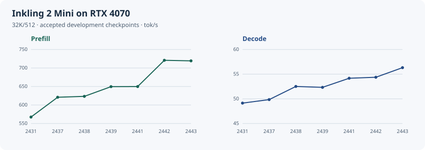

# GooseInfer optimizations

[Applicability matrix on GitHub](MATRIX.md) · [Download Excel](optimization-matrix.xlsx) · [Engineering registry](../goose-migration/FRIED-GOOSE-OPTIMIZATION-REGISTRY.md)

## Confirmed optimizations

| Optimization | Verified scope | Measured result | Evidence |
| --- | --- | --- | --- |
| Reuse a warp's packed activation loads for two output rows | Inkling expanded FP32 Q8 projections with 4096 input rows | 13–29% lower projection kernel time, 5.41% higher 32K/512 prefill and 0.92% lower decode in the immediate comparison. All 512 IDs exact and peak process VRAM held at 9822 MiB. | [EXP-2423](../../experiments/EXP-2026-11-28-2423-inkling-q8-row-pair/README.md) |
| Batch independent verifier attention queries and their merges | Inkling exact Q4 verifier, up to 16 queries with equal partition counts and existing scratch capacity | At 32K/512, decode +19.61%, prefill −0.89%, all 512 IDs exact and peak process VRAM held at 9822 MiB. | [EXP-2424](../../experiments/EXP-2026-11-28-2424-inkling-batched-verifier-attention/README.md) |
| Prepare independent embedding rows on the existing prefill CPU team | Inkling Q8_0 embedding and per-row RMS at the configured parallel prefill sizes | At 32K/512, prefill +15.90%, observed decode +0.79%, all 512 IDs exact and peak process VRAM held at 9822 MiB. | [EXP-2425](../../experiments/EXP-2026-11-28-2425-inkling-parallel-embedding/README.md) |
| Batch independent sliding prefill chunks and their merges | Inkling Q4 sliding prefill, grouping 128-query chunks within existing scratch capacity | At 32K/512, prefill +2.27%, decode −0.78%, all 512 IDs exact and peak process VRAM held at 9822 MiB. | [EXP-2426](../../experiments/EXP-2026-11-28-2426-inkling-sliding-prefill-group/README.md) |
| Reuse a warp's decoded IQ4_XS weights for jobs sharing an expert plane | Inkling exact verifier, 2304-input IQ4_XS and at least 64 jobs | At 32K/512, decode +5.03%, observed prefill +0.20%, all 512 IDs exact and peak process VRAM held at 9822 MiB. | [EXP-2427](../../experiments/EXP-2026-11-28-2427-inkling-iq4-verifier-pairs/README.md) |
| Reuse aligned packed weight loads across consecutive MMA steps | Inkling grouped IQ4_XS and IQ4_NL prefill projections | Large-shape kernel time −11.42% and −7.28%. At 32K/512, prefill +2.75%, observed decode +0.65%, all 512 IDs exact, and peak process VRAM held at 9822 MiB. | [EXP-2429](../../experiments/EXP-2026-11-28-2429-inkling-moe-pairload/README.md) |
| Reuse the CPU row team for short exact verifier batches | Inkling, 8–16 exact verification rows with independent host activation prep | At 32K/512, decode +6.61%, prefill −0.08%, all 512 IDs exact and peak process VRAM held at 9822 MiB. | [EXP-2430](../../experiments/EXP-2026-11-28-2430-inkling-verifier-cpu-team/README.md) |
| Use paired Q4 loads and explicit V accumulators in grouped sliding attention | Inkling grouped Q4 sliding prefill | 1024-query attention and merge time −5.97%. At 32K/512, prefill +0.69%, all 512 IDs exact and peak process VRAM held at 9822 MiB. | [EXP-2431](../../experiments/EXP-2026-11-28-2431-inkling-sliding-prefill-packed/README.md) |
| Use FP16 leading terms and scaled residuals for tiled Tensor Core projections | Inkling expanded Q8_0 prefill shapes, 4096 input rows | Pack and projection time −30–41%. At 32K/512, prefill +9.51%, observed decode +2.08%, all 512 IDs exact and peak process VRAM held at 9822 MiB. Intermediate outputs and expert traffic differ. | [EXP-2437](../../experiments/EXP-2026-11-28-2437-inkling-q8-split-half-mma/README.md) |
| Compute resident expert jobs while the transfer stream loads misses | Inkling exact 16-token verifier with staged expert transfers | At 32K/512, decode +5.56%, observed prefill +0.46%, identical expert transfer bytes and 512 IDs, peak process VRAM 9822 MiB. | [EXP-2438](../../experiments/EXP-2026-11-28-2438-inkling-verifier-expert-overlap/README.md) |
| Share activation tiles across warps with asynchronous CUDA copies | Inkling split-half Q8 prefill, 64-channel staged tiles | Pack-plus-projection time −17–26%. At 32K/512, prefill +5.01%, observed decode −1.34%, all 512 IDs and expert bytes exact, peak process VRAM 9822 MiB. | [EXP-2439](../../experiments/EXP-2026-11-28-2439-inkling-q8-shared-tiles/README.md) |
| Reuse decoded IQ4_NL weights across adjacent verifier jobs | Inkling exact verifier, 1152 inputs and at least 64 jobs | At 32K/512, decode +3.31%, observed prefill −0.40%, exact 512 IDs and expert transfer bytes, peak process VRAM 9822 MiB. | [EXP-2441](../../experiments/EXP-2026-11-28-2441-inkling-iq4-nl-verifier-pairs/README.md) |
| Share and asynchronously stage grouped IQ4 activation tiles | Inkling grouped IQ4_XS and IQ4_NL prefill, 32-job by 64-row full tiles | Large-kernel time −33.25% and −45.79%. At 32K/512, prefill +10.53%, observed decode +2.36%, all 512 IDs and expert traffic exact, peak process VRAM 9822 MiB. | [EXP-2442](../../experiments/EXP-2026-11-28-2442-inkling-iq4-shared-tiles/README.md) |
| Batch the verifier Q8 output projection | Inkling exact 16-token verifier with a Q8_0 output head | At 32K/512, decode +2.86%, observed prefill −0.11%, all 512 IDs and expert transfer bytes exact, peak process VRAM 9822 MiB. | [EXP-2443](../../experiments/EXP-2026-11-28-2443-inkling-verifier-batch-logits/README.md) |

## Experimental candidates

| Candidate | Status | Evidence |
| --- | --- | --- |
| Read CUDA parameter aggregates directly when their address does not need to escape | Experimental | [EXP-1603](../../docs/goose-migration/CUDA-PARITY-EXP1476.md#vector-plans-in-cuda-kernel-parameters) |
| Specialize large CUDA helpers at call sites with constant mode arguments | Experimental | [EXP-1609](../../docs/goose-migration/CUDA-PARITY-EXP1476.md#flash-attention-device-lowering-and-l2-prefetch) |
| Elide empty ownership scopes in borrowed scalar loops | Experimental | [Apex sampler](../../docs/goose-migration/FRIED-GOOSE-OPTIMIZATION-REGISTRY.md#keelwing-ownership-scopes-in-the-apex-sampler) |
| Specialize fixed-size CUDA recurrences and scalar-replace nonescaping arrays | Experimental | [EXP-1719](../../docs/goose-migration/FRIED-GOOSE-OPTIMIZATION-REGISTRY.md#fixed-size-gdn-state-in-registers) |

## Potential directions

| Subsystem | Possible transfer | Status | Evidence or review condition |
| --- | --- | --- | --- |
| Q4_K and Q6_K | Reuse matrix tiles | Potential | Check input layout, alignment and occupancy |
| IQ2 and IQ3 | Reuse activations and decoded weight fragments | Potential | Check quant blocks and route shape |
| MoE and Gate/Up | Share input rows or intermediate values | Potential | Preserve route and gate arithmetic |
| Attention and KV | Reuse blocks of Q/K/V across warps | Potential | Preserve causal masks and windows |
| FlashAttention | Pipeline next-tile loads in shared memory | Potential | Account for staging time and occupancy |
| QKV projections | Reuse activations across projections | Potential | Check layout and end-to-end launch cost |
| MTP verifier | Group independent queries or projection rows | Potential | Preserve verification and rollback |
| Gated DeltaNet | Reuse intermediate state on device | Potential | Check recurrence and lifetime |
| Ternary Bonsai | Share activations across warps | Potential | Check packing and working shape |
| RMSNorm and softmax | Reuse a local reduction | Potential | Measure the synchronization cost |
| RoPE | Reuse positional coefficients | Potential | Check position indexing |
| MoE Top-K | Keep selection and normalized weights on device | Potential | Preserve tie order and weight arithmetic |

## Inkling checkpoint trend

Single-response development measurements on RTX 4070 with Inkling 2 Mini AD-IQ4_XS, Q4_0 KV and a 32K/512 workload. Each point is the published candidate mean from its own experiment.

| Checkpoint | Prefill, tok/s | Decode, tok/s |
| --- | --- | --- |
| [EXP-2431](../../experiments/EXP-2026-11-28-2431-inkling-sliding-prefill-packed/README.md) | 567.43 | 49.14 |
| [EXP-2437](../../experiments/EXP-2026-11-28-2437-inkling-q8-split-half-mma/README.md) | 620.91 | 49.84 |
| [EXP-2438](../../experiments/EXP-2026-11-28-2438-inkling-verifier-expert-overlap/README.md) | 623.44 | 52.51 |
| [EXP-2439](../../experiments/EXP-2026-11-28-2439-inkling-q8-shared-tiles/README.md) | 649.58 | 52.33 |
| [EXP-2441](../../experiments/EXP-2026-11-28-2441-inkling-iq4-nl-verifier-pairs/README.md) | 649.83 | 54.17 |
| [EXP-2442](../../experiments/EXP-2026-11-28-2442-inkling-iq4-shared-tiles/README.md) | 720.83 | 54.38 |
| [EXP-2443](../../experiments/EXP-2026-11-28-2443-inkling-verifier-batch-logits/README.md) | 719.27 | 56.32 |

## Refresh the documentation

After updating the engineering registry, experiment cards or kernel declarations, run `python3 tools/update-optimization-docs.py` from the repository root. The command refreshes this page, the GitHub matrix, the root README summary, the chart and the data in the Excel layout.

Use `coverage.json` to record verified entry names and review conditions. New registry methods enter the matrix even when their kernel coverage is still unassessed. CI runs `python3 tools/update-optimization-docs.py --check` to detect stale public outputs. The generator reads only the public registry, public experiment cards and declared source paths.
